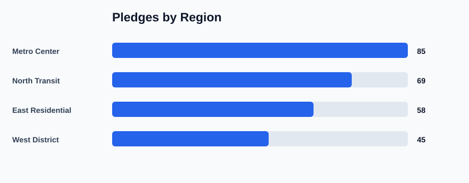
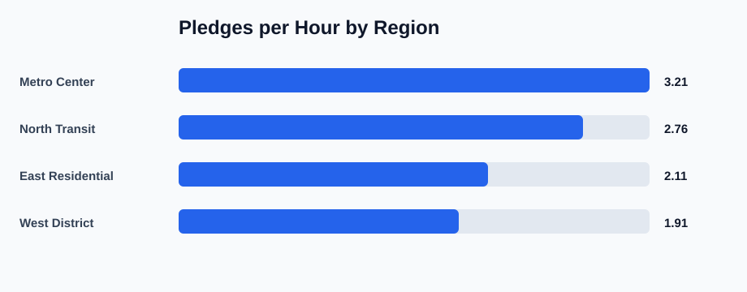
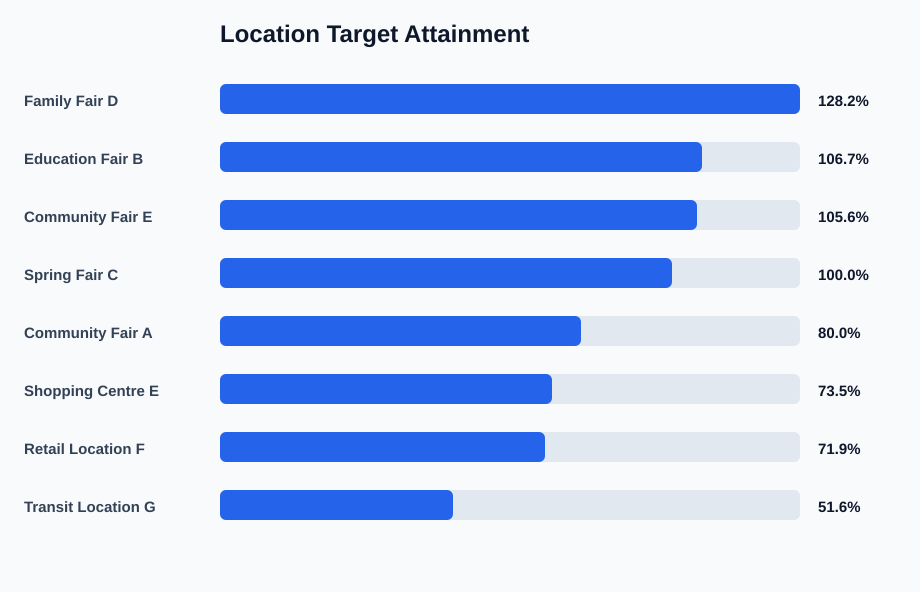

# Nonprofit Fundraising KPI Analysis

Face-to-face fundraising teams collect a lot of numbers: doors knocked, conversations, pledges, hours. This repo turns those exports into something a team leader can act on. It started as a small portfolio analysis and now includes a reusable toolkit, `f2f_kpi`, that works with any team's CSV or Excel export.

All the data here is fictional. See the [privacy note](#data-privacy-note).

## What the toolkit does

- Reads CSV or Excel files, whatever the column names are, using a short YAML file that says which column is which.
- Checks the data and lists every problem with the file row it came from: impossible numbers, bad dates, duplicates, unknown IDs.
- Calculates five KPIs (conversation rate, pledge rate, pledges per hour, target attainment, average monthly donation) by region, by activity type, by fundraiser, by location and by week or month.
- Sorts locations into planning tiers such as "Scale or repeat" or "Review before repeating". You set the thresholds.
- Writes one Excel workbook with the results, charts and a sheet of data issues.
- Offers all of this in a browser app too, if you'd rather upload a file than use the command line.

## How it fits together

All the logic lives in one package, `src/f2f_kpi/`. The command line, the Excel report and the web app are thin layers on top of it, so they always give the same numbers.

```text
file (.csv / .xlsx)
   -> io.py          read it as text, remember each row's line number
   -> mapping.py     rename your columns to ours, using the YAML config
   -> validate.py    parse numbers and dates, collect every problem, drop the unusable rows
   -> kpis.py, trends.py, classify.py    the five KPIs, trends, location tiers
   -> engine.py      runs the steps above and returns one result object
   -> report/        Excel workbook          cli.py   command line          app/   web app
```

## Install

You need Python 3.10 or newer. I developed and tested it on Python 3.12.

```bash
git clone https://github.com/hredoymesha/fundraising-kpi-analysis.git
cd fundraising-kpi-analysis
python -m venv .venv
.venv\Scripts\activate          # macOS and Linux: source .venv/bin/activate
pip install -e .
```

The web app needs two more packages, Streamlit and Plotly: `pip install -e ".[app]"`. To run the tests, use `pip install -e ".[dev]"`, which includes the app packages.

## Quick start

The repo includes synthetic sample data. This builds a report from it:

```bash
python -m f2f_kpi report data/sample/shifts.csv --config config/default_mapping.yaml
```

You get `f2f_kpi_report.xlsx` in the current folder and a short summary in the terminal. Add `--locations data/sample/locations.csv` to fill in the Locations sheet, and `--output` to choose where the file goes.

After installing, the shorter `f2f-kpi` command does the same thing as `python -m f2f_kpi`.

The sample shifts contain a handful of deliberate mistakes so you can see the checks at work. They are listed in `data/sample/injected_errors.csv`.

## Try it without Git

You don't need to know Git to run the toolkit. You need Python 3.10 or newer. Check with `python --version`; if it isn't installed, get it from python.org and tick "Add python.exe to PATH" in the installer.

1. Open the [Releases page](https://github.com/hredoymesha/fundraising-kpi-analysis/releases), choose the latest release, and download **Source code (zip)**.
2. Extract it. Windows may create a folder inside a folder of the same name. Open the inner one, the one that contains `README.md` and `pyproject.toml`.
3. Open PowerShell in that folder (in File Explorer, click the address bar, type `powershell` and press Enter) and run:

   ```powershell
   python -m venv .venv
   .\.venv\Scripts\python.exe -m pip install -e ".[app]"
   ```

   This creates a private Python environment and installs the toolkit and the web app. It takes a minute or two.

4. Build a report from the sample data:

   ```powershell
   .\.venv\Scripts\f2f-kpi.exe report data/sample/shifts.csv --config config/default_mapping.yaml
   ```

   `f2f_kpi_report.xlsx` appears in the folder. Open it in Excel.

5. Or start the web app:

   ```powershell
   .\.venv\Scripts\streamlit.exe run app/streamlit_app.py --server.address localhost --browser.gatherUsageStats false
   ```

   Open `http://localhost:8501`, press **Try it with sample data**, and look around. Press `Ctrl+C` in PowerShell to stop it.

These steps were tried on Windows. On macOS or Linux, use `.venv/bin/python`, `.venv/bin/f2f-kpi` and `.venv/bin/streamlit` in place of the `.\.venv\Scripts\...` paths.

##  your own export

1. **See how your columns match.** `f2f-kpi profile my_export.csv` reads the file and suggests which column is the pledge count, which is the hours, and so on. Check the lines it marks "check this one".
2. **Create a config.** `f2f-kpi init-config my_export.csv -o my_team.yaml` writes a starter config with that mapping filled in.
3. **Check the data first.** `f2f-kpi validate -c my_team.yaml` lists every problem and writes nothing.
4. **Build the report.** `f2f-kpi run -c my_team.yaml -o report.xlsx`.

If your export is a single file and the defaults suit you, skip the config: `f2f-kpi report my_export.csv`.

### Commands

| Command | What it does |
|---|---|
| `report INPUT [-c CONFIG] [--locations FILE] [-o OUT]` | Excel report from one activity file. The config is optional. |
| `run -c CONFIG [-o OUT]` | Excel report from the files named in the config. |
| `validate -c CONFIG` | Lists data problems. Writes no report. |
| `profile INPUT [--dataset NAME] [--sheet NAME] [--header-row N]` | Suggests which column is which. |
| `init-config [INPUT] -o FILE` | Writes a starter config. Won't overwrite a file unless you add `--force`. |

`report`, `run` and `validate` take `--strict`, which counts warnings as failures too. That is handy in an automated check.

Exit codes: `0` means it finished. `1` means `validate` found errors, or `report` / `run` had no usable rows left, or `--strict` met any issue (warnings included). `2` means the config or a file could not be used. A report with some rows left out still exits `0`, so look at the summary or run `validate` first.

## The web app

If you'd rather click than type commands, there is a browser app:

```bash
pip install -e ".[app]"
streamlit run app/streamlit_app.py --server.address localhost --browser.gatherUsageStats false
```

It opens at `http://localhost:8501`. The two flags keep the app on your own computer and switch off Streamlit's usage statistics. They matter: the same settings are in `.streamlit/config.toml`, but Streamlit only reads that file from the folder you start it in. The app shows a warning if it finds itself reachable from the network.

1. **Upload** an activity file in the sidebar (CSV or Excel). Add a location list too if you want target attainment and the location ranking. Or press *Try it with sample data*.
2. **Check the column matching.** The app guesses from the headers, and you fix any dropdown that's wrong. Required fields are marked, and it tells you which ones are still missing.
3. **Look around.** Five KPI cards, charts by region and over time, a location ranking with the same planning tiers as the report, and a table of every data problem with the row it came from. Filter by region and date in the sidebar and everything recalculates.
4. **Download the Excel report.** It's the same workbook the command line makes, and it always covers every usable row, whatever the filters are set to.

Odd file? Under *Reading options* in the sidebar you can pick the Excel sheet, the row the column names are on, the CSV separator and the text encoding. *Number and date format* handles comma decimals and dates like `31.03.2024`. If you already have a YAML config for the command line, upload it under *Settings file* to use its column mapping, thresholds and tiers (file paths inside it are ignored).

## Configuration

`config/default_mapping.yaml` is a fully commented template. Every setting is optional except the location of your activity file. The parts you will touch most:

```yaml
inputs:
  activity: data/export.xlsx          # or {path: ..., sheet: Daily, header_row: 3}
  locations: data/locations.csv       # optional; adds target PPH and the Locations sheet

columns:
  activity:
    region: ["Area", "Region"]        # our field name: the header(s) in your file
    pledges: "Sign-ups"
    active_hours: "Hours worked"

formats:
  decimal: ","                        # 4,5 instead of 4.5
  date: "%d.%m.%Y"

classification:
  min_hours: 20                       # fewer hours than this: "Insufficient data"
  tiers:
    - {label: "Scale or repeat",         min: 1.00}
    - {label: "Keep and monitor",        min: 0.75}
    - {label: "Review before repeating", min: 0.0}
```

Paths are relative to the config file. A header matches a field name if the two are equal apart from capital letters and outer spaces, so `Region` finds `region` but `Active Hours` does not find `active_hours`. List such headers under `columns`, or let `profile` suggest them.

### Columns the activity file needs

You need three things: a region, a pledge count and the active hours. Everything else is optional, and a KPI whose inputs are missing is left out and noted in the report. With dates you get the Trends sheet, with `activity_type` and `fundraiser_id` you get By Dimension, and a location list with `target_pph` gives you Locations.

### Reading the data issues

Every problem comes with the **source row** (the line in your file, counting the column names as the first line, or the Excel row), the **column**, the **value found** and a plain description. An **error** means the row is left out of every figure. A **warning** means the row is kept and worth a look, or was tidied up. Change any rule under `validation.severity`, or set it to `ignore`.

| Problem | Default |
|---|---|
| Missing column, blank required value, text where a number belongs, unreadable date | error |
| Negative values, zero hours with pledges, more conversations than doors, more pledges than conversations | error |
| Exact duplicate row (the first copy is kept) | error |
| A location ID repeated in the location list (the first row is used) | error |
| Hours or value per pledge far above the limits you set, date far from the rest, unknown fundraiser or location ID | warning |
| Same region spelled two ways (it is tidied up to the common spelling) | warning |
| Supplied `achieved_pph` that does not match pledges ÷ hours (the recalculated figure is used) | warning |

### Location classification

Each location's **target attainment** is its achieved pledges per hour divided by its target. Tiers are checked from the highest minimum down, and a minimum is inclusive: with the defaults, exactly 75% is "Keep and monitor". Locations with fewer than `min_hours` in total are labelled "Insufficient data" instead, because a handful of hours says little. Locations with no usable target get the same label.

Tiers are plain labels with minimums, so you can rename them, add more, or give one kind of location its own bar:

```yaml
classification:
  tiers_by_type:
    Fair:
      - {label: "Scale or repeat",         min: 1.20}
      - {label: "Review before repeating", min: 0.0}
```

The lowest tier must have a minimum of 0 or less, so every location gets a label.

## What's in the workbook

| Sheet | Contents |
|---|---|
| Summary | Headline KPIs, a few plain-language findings, how many rows were read and used, issue counts |
| By Region | The five KPIs for each region, with colour scales and data bars |
| By Dimension | The same, by activity type and by fundraiser |
| Locations | Target attainment, planning tier and a one-line reason for each location |
| Trends | Weekly or monthly figures, change on the previous period, a four-period rolling pledges per hour, and three charts you can edit in Excel |
| Data Issues | Every problem: which file row, which column, what was found, what is wrong |
| Methods | KPI definitions and the exact limits and thresholds used, so the numbers can be audited |

Text from your file that starts with `=` is stored as plain text, so a hostile spreadsheet value cannot turn into a formula in the report.

## How the KPIs are calculated

```text
conversation rate    = conversations / doors_knocked
pledge rate          = pledges / conversations
pledges per hour     = pledges / active_hours
target attainment    = achieved_pph / target_pph
avg monthly donation = total_monthly_value_eur / pledges
```

The web app's card for the last one is called "Average monthly gift".

Three rules apply everywhere:

- Totals are added up before dividing, so a region's pledge rate is its total pledges over its total conversations, not an average of daily rates.
- If the bottom of a fraction is zero, the result is left blank instead of showing 0%. A region with no conversations has no pledge rate. It did not have a bad one.
- Rows with errors are not counted at all.

A location's target PPH is the average of its row targets weighted by hours worked, and the overall target attainment on the web app's card is total pledges divided by the pledges the targets would have predicted.

##  it from Python

The calculations don't depend on the command line or on Excel.

```python
from f2f_kpi import load_config, run, write_report

config = load_config("config/sample.yaml")
result = run(config)

result.by_region       # KPIs per region
result.by_location     # per location, with planning_priority
result.by_dimension    # per activity type and fundraiser
result.trends          # per week or month
result.issues          # every data problem, as a table

write_report(result, config, "report.xlsx")
```

## Sample data

`data/sample/` holds synthetic data from `generate_sample_data.py`: 12 weeks, 5 regions, 30 locations and 40 fundraisers who appear only as IDs (`F001`–`F040`). The generator is seeded, so it produces the same files every time. `injected_errors.csv` records each planted mistake and where it is: 13 in `shifts.csv` (bad counts, hours and dates, a text value in a number column, an unknown fundraiser ID, an inconsistent region spelling, one duplicated row) and one wrong `achieved_pph` in `location_weekly.csv`. The tests check that every one is found.

The two small files in `data/` are the ones the original script uses.

## Tests and automated checks

```bash
pip install -e ".[dev]"
pytest
```

The tests cover the engine with hand-calculated expected values, the sample data's planted errors, the command line, the Excel workbook, and the web app (driven through Streamlit's own test tool). `.github/workflows/tests.yml` runs the same `pytest` command on every push and pull request.

## Troubleshooting

| What you see | What to do |
|---|---|
| `No column found for the required field 'active_hours'` | Your header is named differently. Run `f2f-kpi profile your_file.csv`, or list the header under `columns` in the config. The message names the likely match. |
| `unparseable_date` | Dates must be `2024-03-31` style unless you set `formats.date`, for example `"%d.%m.%Y"`. |
| Numbers like `4,5` are rejected | Set `formats.decimal: ","`. With a decimal comma, a dot is read as a thousands separator (`1.234,5`). With a decimal point, thousands separators like `1,234.5` are not supported, so remove them. |
| `is not readable as utf-8 text` or garbled accents | Set `encoding` for that file in the config (for example `cp1252` or `latin-1`), or pick the text encoding in the web app. |
| Rows seem to be missing | Check the Data Issues sheet. Identical rows count as duplicates, which is wrong if your export has no shift or fundraiser column and repeats are real. Add such a column, or set `exact_duplicate_row: warning` under `validation.severity`. |
| An Excel file shows no data | Choose the right sheet and header row: `inputs.activity: {path: ..., sheet: Daily, header_row: 3}`, or *Reading options* in the web app. |
| Every location is "Insufficient data" | Total hours are under `classification.min_hours`. Lower it for small data sets. |
| A far-away date stretches the trend charts | By default it is only a warning. Set `date_out_of_range: error` to leave such rows out. |
| `ModuleNotFoundError: streamlit` | Install the app packages: `pip install -e ".[app]"`. |
| The report can't be written | The message says so. If `report.xlsx` is open in Excel, close it. |
| The web app warns that other computers can reach it | Restart it with `--server.address localhost` as shown above. |

## The first version: goals, tools and data

These notes are from the first version of the project, a small analysis of two sample files. They are kept as they were written.

### Project Goals

- Compare pledge performance by region
- Calculate conversation rate and pledge conversion rate
- Compare pledges per hour across regions
- Compare achieved PPH against target PPH by location
- Classify locations for future planning decisions
- Produce simple charts and written insights

### Tools Used

- Python
- CSV
- KPI calculations
- Business reporting
- SVG charts generated with Python

### Dataset

The sample datasets are stored in:

- `data/fundraising_kpi_sample.csv`
- `data/location_performance_sample.csv`

Important columns include:

- region
- activity type
- doors knocked
- conversations
- pledges
- total monthly value
- active hours
- location type
- target PPH
- achieved PPH
- average monthly donation

### Example Insights

- Identify the highest-performing region by total pledge volume.
- Identify the most productive region by pledges per hour.
- Compare location performance against target PPH.
- Mark weak locations for review before repeating.
- Use weekly reporting to support coaching and planning.

## The original analysis script

The first version of this project is still here. It reads the two files in `data/` and produces summary tables, short insights and three charts:

```bash
python src/analyze_kpis.py
```

It writes to `outputs/`:

- `area_kpi_summary.csv`
- `location_kpi_summary.csv`
- `insights.md`
- `pledges_by_region.svg`
- `pledges_per_hour_by_region.svg`
- `location_target_attainment.svg`

### Pledges by Region



### Pledges per Hour by Region



### Location Target Attainment



## Project layout

```text
config/          default_mapping.yaml (commented template), sample.yaml (for the sample data)
data/            the original two sample files
data/sample/     synthetic data, its generator and the list of planted errors
src/f2f_kpi/     the toolkit: config, io, mapping, validate, kpis, trends, classify, engine, report/, cli
app/             the Streamlit web app (streamlit_app.py, plus app_logic.py and figures.py)
.streamlit/      app settings: local-only, no usage statistics
.github/         the test workflow
src/analyze_kpis.py   the original script
tests/           pytest suite
outputs/         output of the original script
```

## Project context

Team leaders need to see activity volume and conversion quality together. A good location is not just the one with the most conversations. It is the one that turns conversations into pledges efficiently and meets its productivity target, which is what makes it worth booking again.

## Data privacy note

The data in this repository is fictional. It contains no real organisational data, employee-level results, route plans or confidential location results.

The toolkit runs on your own computer and makes no network connections. In the web app, your file stays in memory while the page is open, and its contents are never written to logs. One small exception: while building the Excel report, the spreadsheet library briefly writes temporary files to your temp folder and deletes them right away. If someone else hosts the web app, your file does reach their server, so run it locally for real exports. Keep real exports and the reports generated from them out of version control.

## Limits to know about

- The workbook holds calculated values, not live formulas, so changing a number in Excel won't update the rest.
- Trends are by calendar week (Monday start) or month.
- Breakdowns are limited to activity type, fundraiser and location.
- Dates must be in one format per file.
- The web app takes one activity file and one location list. The weekly and fundraiser lists the command line accepts aren't offered there.
- In the web app, the downloaded report covers every usable row, not just the filtered view.
- The web app's column dropdowns and charts were checked in a real browser with the sample data and with one uploaded file, but not with every kind of file, and I could not capture screenshots reliably, so there are none here.

## Key Skills Demonstrated

- Data cleaning and grouping
- KPI calculation
- Performance comparison
- Location planning logic
- Business-focused interpretation
- Clear project documentation
- Public-safe handling of professional-style analysis
- Data validation and automated testing
- Python packaging and command-line design
- Excel reporting and a Streamlit web app

## Ideas for later

- A Power BI dashboard built on the same sample data
- A public-safe map using fictional coordinates
- SQL queries for the same dataset
